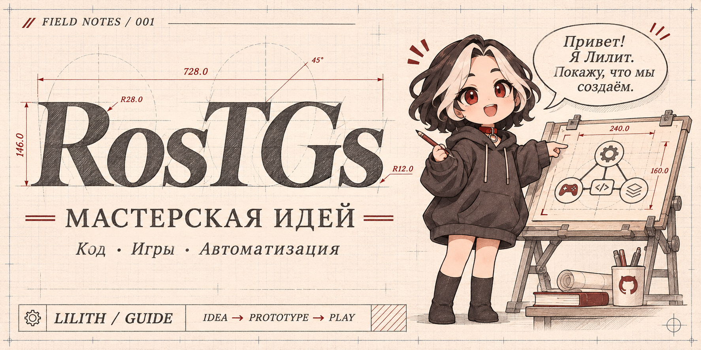
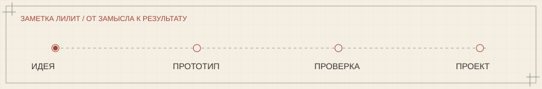
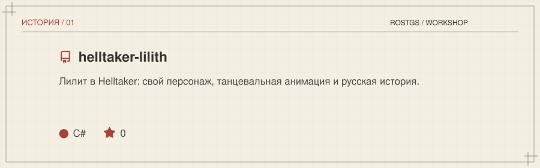
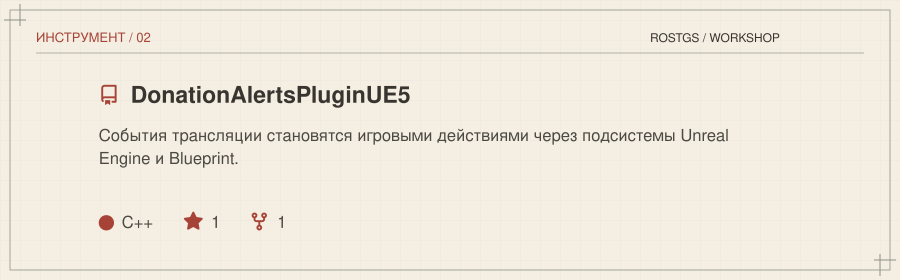
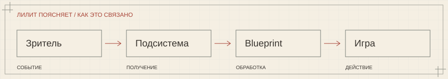
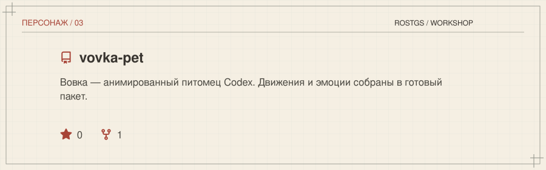
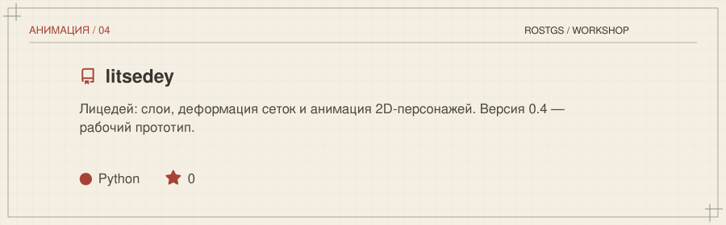
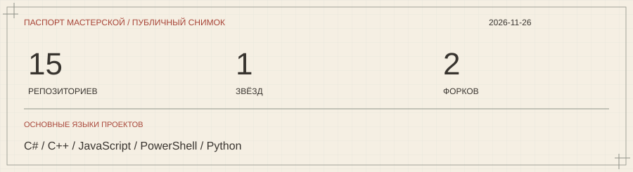

  

<a href="#экспонат-01--helltaker--лилит">Игры</a> · <a href="#экспонат-02--стрим-становится-частью-игры">Unreal Engine</a> · <a href="#экспонат-03--персонаж-на-рабочем-столе">Персонажи</a> · <a href="#экспонат-04--лицедей-рисунок-обретает-движение">2D-анимация</a> · <a href="https://github.com/RosTGs?tab=repositories">Все репозитории ↗</a>

> **Лилит, проводник по мастерской:** «Привет! Здесь идеи превращаются в игровые истории, инструменты и маленьких живых персонажей. Давай покажу четыре проекта поближе».

### Экспонат 01 · Helltaker · Лилит

> **Лилит:** «А здесь я сама в главной роли! Свой образ, танец в ритме музыки и история на русском. Загляни в галерею — там мой мир в деталях».

[Галерея и история →](https://github.com/RosTGs/helltaker-lilith/blob/main/docs/GALLERY.md) · [Скачать релиз →](https://github.com/RosTGs/helltaker-lilith/releases/latest)

### Экспонат 02 · Стрим становится частью игры

> **Лилит:** «Смотри на цепочку: событие зрителя → Blueprint → действие в игре. DonationAlerts связывает трансляцию с игровым миром. Автор игры выбирает, как именно мир отреагирует».

[Открыть плагин →](https://github.com/RosTGs/DonationAlertsPluginUE5) · [Подключить интеграции →](https://github.com/RosTGs/DonationAlertsPluginUE5/blob/main/Docs/Integrations.md)

### Экспонат 03 · Персонаж на рабочем столе

> **Лилит:** «Знакомься, Вовка! Лист кадров превращается в движения и эмоции, а готовый пакет — в питомца Codex. Люблю, когда у рабочего пространства появляется характер».

<b>Лилит показывает лист движений Вовки</b>

[Забрать питомца →](https://github.com/RosTGs/vovka-pet)

### Экспонат 04 · Лицедей: рисунок обретает движение

> **Лилит:** «Здесь рисунок собирается в персонажа: слои, сетки, формы движения и анимация. Посмотри на Миру — она дышит, моргает и переводит взгляд. Её готовую модель можно открыть в редакторе и изучить изнутри».

**Рабочий прототип 0.4.** Демонстрация Миры собрана и отрендерена скриптами эксперимента на ядре редактора. Подготовленные детали, параметры движения и девятисекундная петля доступны в редактируемом примере. Документированный проверенный запуск — macOS; подробности подготовки среды находятся в README проекта.

<b>Лилит показывает анимацию Миры</b>

[Открыть редактор и инструкцию запуска →](https://github.com/RosTGs/litsedey) · [Первое движение →](https://github.com/RosTGs/litsedey/blob/main/docs/first-steps.md) · [Пример Миры →](https://github.com/RosTGs/litsedey/blob/main/docs/examples/Mira-demo-light.l2dstudio.zip) · [Возможности и границы прототипа →](https://github.com/RosTGs/litsedey#ограничения-04)

### На полях чертежа

> **Лилит:** «Здесь — свежий снимок публичной мастерской. За каждой карточкой лежит проект: открывай, рассматривай и пробуй».

Чертёж ведёт RosTGs · Экскурсию проводит Лилит · Карточки на основе <a href="https://github.com/tryshyzov/readme-cards">readme-cards</a> · <a href="DESIGN.md">Устройство оформления</a>

